# AgentCraft ⚡ / RakshaGrid 🛡️
### Autonomous AI Disaster Intelligence & Emergency Response Platform
**AGENTCRAFT 2026 National AI Agent Challenge**

[](https://www.python.org/)
[](https://fastapi.tiangolo.com/)
[](https://react.dev/)
[](https://vitejs.dev/)
[](https://www.docker.com/)
[]()
[-00f0ff.svg)]()
[]()

> **AgentCraft / RakshaGrid** is a production-hardened, demonstration-ready autonomous AI disaster intelligence and emergency response platform. It unifies multi-hazard incident management, spatial GIS tracking, resource inventory allocation, shelter capacity monitoring, hydro-meteorological data integration, explainable risk modeling, hypothetical disaster scenario simulations, Common Alerting Protocol (CAP) broadcasts, and an AI response coordinator equipped with verifiable safety decision gates.

---

## 🎯 Problem Statement & Core Mission

During disaster emergencies, responders and command centers face critical coordination bottlenecks:
1. **Information Fragmentation**: Real-time river levels, weather forecasts, shelter occupancies, team positions, and supply inventories reside in disjointed silos.
2. **Unverified AI Hallucinations**: Standard LLMs often invent situational facts, hallucinate resource availability, or suggest hazardous dispatch orders without checking constraints or verification gates.
3. **Flawed Inventory & Capacity Operations**: In crisis conditions, manual tracking often produces negative inventory, invalid occupancy calculations, and uncoordinated duplicate dispatches.
4. **Black-Box Decision Support**: Field commanders cannot trust non-transparent risk scores that lack factor breakdowns or data provenance.

### The Proposed Solution: AgentCraft / RakshaGrid

**AgentCraft / RakshaGrid** bridges this divide by enforcing deterministic reliability, mathematical verification gates, and human-in-the-loop oversight:
- **Verifiable AI Engine**: Every agent step operates through typed tools subclassing `BaseTool`, validating inputs, querying persistent database entities, and evaluating assertions with `VerifierTool`.
- **Human Approval Decision Gates**: Consequential operational dispatches (team deployment, task assignment, status updates) require explicit commander authorization.
- **Relational & Transactional Integrity**: Row-level locking, atomic transactions, and capacity check constraints prevent negative inventory, over-allocated shelters, or duplicate dispatches.
- **Explainable Multi-Hazard Risk Scoring**: A 0–100 risk calculation weighting hazard category, severity, status, live telemetry, and exposure, with explicit factor attribution and data gap penalties.
- **Zero-Dependency Resilience**: Works out of the box with zero external API keys via heuristic/deterministic reasoning, while seamlessly elevating to OpenAI, Gemini, or Anthropic models when configured.

---

## 🏛️ System Architecture

```mermaid
flowchart TD
    subgraph UI ["Frontend Mission Control (React 19 + Vite)"]
        A1[RakshaOverview - Live Dashboard]
        A2[RakshaIncidents - Incident Management]
        A3[RakshaLiveMap - GIS Spatial Tracker]
        A4[RakshaRiskAnalysis - Risk Scoring & Simulations]
        A5[RakshaAgent - AI Response Coordinator]
        A6[RakshaAlerts - Broadcast & CAP Alerts]
        A7[RakshaSettings - System Diagnostics & Seeder]
    end

    subgraph Security ["Security & Rate Limiting Layer"]
        S1[SlidingWindowRateLimiter]
        S2[Role-Based Authorization & Token Audit]
        S3[Production Safe Exception Handler]
    end

    subgraph Backend ["FastAPI Backend Services"]
        B1[Incident & Timeline Service]
        B2[Coordination & Resource Manager]
        B3[Risk Engine - 0 to 100 Scoring]
        B4[Simulation Sandbox - State Isolated]
        B5[Alert Service - CAP & Deduplication]
        B6[External Data Service - Weather & Flood APIs]
    end

    subgraph AI_Engine ["AI Reasoning Engine (ai/)"]
        E1[AgentCraftAgent Cognitive Loop]
        E2[Disaster Response Tools - 8 Typed Tools]
        E3[VerifierTool - Multi-Criteria Assertions]
        E4[Human-in-the-Loop Decision Gate]
    end

    subgraph Storage ["Data Layer"]
        D1[(PostgreSQL / SQLite Database)]
        D2[(In-Memory Cache & Observables)]
    end

    UI -->|HTTP / REST + JSON| Security
    Security --> Backend
    Backend <--> AI_Engine
    Backend <--> Storage
    AI_Engine <--> Storage
```



---

## 💻 Technology Stack

| Layer | Technologies & Libraries |
|---|---|
| **AI Reasoning Engine** | Python 3.12, `BaseTool`, `ToolParameter`, `ToolResult`, `VerifierTool`, Sandboxed Code Runner, Multi-Provider Fallback (OpenAI, Gemini, Anthropic, Heuristic) |
| **Backend API** | FastAPI 0.110+, Pydantic v2 (strict schemas & validation), Uvicorn, Python-Multipart |
| **Database & ORM** | SQLAlchemy 2.0, Alembic 1.13+ migrations, PostgreSQL 16 (production) / SQLite3 (offline zero-config), Psycopg 3 |
| **Frontend UI** | React 19, Vite 8.3, Vanilla CSS (Cyberpunk-Glass aesthetic, responsive desktop/tablet/mobile layouts) |
| **External Integrations** | Open-Meteo Weather Forecast API, Open-Meteo River Discharge & Flood API, in-memory TTL cache |
| **Testing & Quality** | Pytest 8.4, Pytest-Asyncio, HTTPX TestClient, ESLint (zero errors) |
| **Container & Ops** | Multi-stage Dockerfile (Node 20 build + Python 3.12-slim runtime), Docker Compose |

---

## 📁 Project Structure

```text
AGENTCRAFT/
├── .agents/
│   └── skills/                         # Antigravity operational skills & runbooks
├── ai/
│   ├── agent.py                        # Core AgentCraftAgent, PlanStep, AgentState
│   ├── README.md                       # AI cognitive loop & specification
│   ├── tools/
│   │   ├── __init__.py                 # Tool registry & dispatcher
│   │   ├── base.py                     # BaseTool, ToolResult, ToolParameter
│   │   ├── disaster_tools.py           # 8 Phase 4 typed disaster operations tools
│   │   ├── code_runner.py              # Sandboxed Python execution engine
│   │   ├── file_manager.py             # Path-safe file operations
│   │   ├── data_analyzer.py            # Statistical analysis & outlier detection
│   │   ├── web_fetcher.py              # HTTP client & structured data retrieval
│   │   └── verifier.py                 # Multi-criteria contract-based assertion engine
│   └── tests/                          # AI engine & verification tests
├── backend/
│   ├── app.py                          # FastAPI application entrypoint & static mount
│   ├── requirements.txt                # Production dependencies
│   ├── database/
│   │   ├── session.py                  # Database engine, sessionmaker & transactions
│   │   └── migrations/                 # Alembic migrations (0002_phase2_incident_management)
│   ├── rakshagrid/
│   │   ├── config.py                   # Pydantic BaseSettings & configuration
│   │   ├── models.py                   # 13 SQLAlchemy models (Incidents, Shelters, Teams, Alerts, etc.)
│   │   ├── security.py                 # Phase 5 sliding-window rate limiters & sanitizers
│   │   ├── service.py                  # Telemetry, health checks, & live overview metrics
│   │   ├── auth.py                     # Role-based access control & token verification
│   │   └── incident_schemas.py         # Validated request/response schemas
│   ├── routes/
│   │   ├── agent_routes.py             # Agent execution REST endpoints
│   │   ├── alert_routes.py             # Alert broadcasting & lifecycle endpoints
│   │   ├── coordination_routes.py      # Teams, Shelters, Tasks, Resources endpoints
│   │   ├── incident_routes.py          # Incident CRUD & situation updates
│   │   ├── intelligence_routes.py      # Weather, Risk, Simulation, & AI agent endpoints
│   │   └── rakshagrid_routes.py        # System health & overview diagnostics
│   ├── scripts/
│   │   └── seed_dev_data.py            # Deterministic, safe development data seeder
│   ├── services/
│   │   ├── alert_service.py            # Deduplicated alert broadcasting
│   │   ├── benchmark_service.py        # AGENTCRAFT 2026 capability benchmarks
│   │   ├── disaster_agent_service.py   # AI response coordinator with decision gates
│   │   ├── external_data_service.py    # Hydro-meteorological external data integration
│   │   ├── risk_engine.py              # Explainable 0-100 risk scoring
│   │   └── simulation_service.py       # State-isolated disaster simulations
│   └── tests/                          # 132 pytest unit, integration, and security tests
├── docs/                               # Architecture, evaluation, API, and limitation docs
├── frontend/
│   ├── src/
│   │   ├── components/rakshagrid/      # Mission Control UI views (Overview, Map, Risk, etc.)
│   │   ├── App.jsx                     # Top-level shell and tab navigation
│   │   └── index.css                   # Responsive Cyberpunk-Glass design system
│   ├── index.html                      # Semantic HTML5 entrypoint
│   ├── package.json                    # Frontend dependencies (React 19, Vite 8)
│   └── vite.config.js                  # Vite production build & dev proxy config
├── Dockerfile                          # Multi-stage production container definition
├── docker-compose.yml                  # Multi-service stack (PostgreSQL 16 + AgentCraft App)
├── .dockerignore                       # Docker build exclusion rules
├── .env.example                        # Documented environment variables template
├── alembic.ini                         # Database migration configuration
├── AGENTS.md                           # Strict repository directives & naming guidelines
└── README.md                           # Master project documentation
```

---

## ⚡ Quickstart & Installation

### 1. Prerequisites
- **Python**: 3.12 or higher
- **Node.js**: 20 or higher & npm
- **Docker & Docker Compose** *(Optional, for containerized deployment)*

### 2. Local Setup (Bare Metal / Development)

```bash
# 1. Clone repository
git clone https://github.com/singhrohit09/AGENTCRAFT.git
cd AGENTCRAFT

# 2. Setup Python Virtual Environment
python -m venv .venv
.\.venv\Scripts\Activate.ps1    # On Windows PowerShell
# source .venv/bin/activate     # On Linux/macOS

# 3. Install Python Dependencies
pip install -r backend/requirements.txt

# 4. Configure Environment
copy .env.example .env          # On Windows
# cp .env.example .env          # On Linux/macOS

# 5. Setup Frontend
cd frontend
npm install
cd ..
```

---

## ⚙️ Running the Platform

### Mode A: Concurrent Development Servers
```bash
# Terminal 1 — Backend FastAPI Server:
.\.venv\Scripts\python.exe -m uvicorn backend.app:app --host 127.0.0.1 --port 8000 --reload
# OpenAPI Swagger docs available at: http://127.0.0.1:8000/docs

# Terminal 2 — Frontend Dev Server:
cd frontend
npm run dev
# Mission Control UI available at: http://localhost:3000
```

### Mode B: Single-Port Production Mode
FastAPI automatically serves prebuilt static assets from `frontend/dist/` when present:
```bash
# 1. Build frontend bundle
cd frontend
npm run build
cd ..

# 2. Run backend
.\.venv\Scripts\python.exe -m uvicorn backend.app:app --host 0.0.0.0 --port 8000
# Entire application (UI + API) served directly at: http://localhost:8000
```

### Mode C: Docker Compose (Production Stack)
```bash
# Build and launch PostgreSQL and AgentCraft App
docker-compose up -d --build

# View container logs
docker-compose logs -f app

# Access platform
# Mission Control UI: http://localhost:8000
# Backend Health Check: http://localhost:8000/api/rakshagrid/health
```

---

## 🧪 Testing & Verification

AgentCraft maintains a comprehensive test suite covering unit tests, API integration tests, database persistence, transaction rollbacks, rate limiting, and verification gates.

```bash
# Execute full test suite (132 passed tests)
.\.venv\Scripts\python.exe -m pytest ai/tests backend/tests -v
```

### Run AGENTCRAFT 2026 Capability Benchmark
```bash
.\.venv\Scripts\python.exe -c "from backend.services.benchmark_service import benchmark_service; res = benchmark_service.run_suite(); print('VERDICT:', res['system_verdict'], 'COMPLETION:', res['completion_rate_pct'])"
```
**Expected Output:**
```text
VERDICT: CERTIFIED COMPLETION: 100.0
```

### Run Frontend Build & Lint Checks
```bash
cd frontend
npm run lint    # 0 errors
npm run build   # Vite bundle built in <400ms
cd ..
```

---

## 🛡️ Security Hardening

AgentCraft / RakshaGrid implements Defense-in-Depth security principles:
1. **Thread-Safe Sliding-Window Rate Limiting**: Sensitive and computation-heavy endpoints (`/intelligence/agent/analyze`, `/simulations/run`, `/alerts/evaluate`, `/api/agent/run`) are throttled against DoS attacks using an in-memory sliding window algorithm.
2. **Production-Safe Exception Masking**: When `AGENTCRAFT_DEBUG=false`, internal stack traces and server internals are suppressed in API responses, logging details server-side while returning generic safe error messages.
3. **Role-Based Authorization (RBAC)**: All destructive actions (incident deletion, task termination, alert cancellation) require verified `admin` or `field_commander` roles.
4. **Prompt Injection Sanitization**: AI agent prompts strip system prompt overrides, delimiter manipulation attempts, and unauthorized execution directives.
5. **Human Approval Decision Gates**: The AI agent proposes structured operational plans with formal schemas; execution requires an explicit `POST /api/v1/intelligence/agent/plan/approve` invocation from an authorized human operator.
6. **Path Traversal Sandboxing**: Code and file operations reject path traversals attempting to escape `./temp_sandbox`.
7. **Zero Secret Leakage**: No API keys or credentials are committed to version control.

---

## 📊 Core User Workflows & Demonstration Guide

### 1. Incident Management
- Create new disaster events with geocoded coordinates, categories (flood, cyclone, earthquake, landslide, industrial), and initial severity.
- View real-time situation updates and chronologically audited incident histories.
- Filter by status (`reported`, `verified`, `response_active`, `contained`, `resolved`, `closed`).

### 2. Live Response Coordination
- **Response Teams**: Track NDRF, SDRF, Medical, HAZMAT, and Drone units with status lifecycles (`available`, `assigned`, `deployed`, `resting`).
- **Shelters**: Real-time capacity vs. occupancy tracking. Checks enforce that occupancy never exceeds maximum capacity.
- **Resources**: Track stockpiles (medical kits, water purifiers, rescue rafts, generators). Transactional safeguards guarantee that allocations never produce negative inventory.

### 3. Disaster Intelligence & Risk Modeling
- Calculate 0–100 risk indices dynamically combining hazard category, severity, status, live river discharge, precipitation, and population density.
- Review transparent contributing factors: baseline hazard, operational status, and real-time environmental telemetry.

### 4. Hypothetical Disaster Scenario Simulations
- Test emergency preparedness against 6 stress scenarios:
  1. Heavy Rainfall (River Surge + 150mm rain)
  2. Multi-Incident Concurrency Spike
  3. Response Team Unavailability Outage
  4. Shelter Capacity Overflow Surge
  5. Critical Medical Supply Shortage
  6. Compound Cascading Disaster
- **Guaranteed Isolation**: All simulations compute hypothetical projections in isolated execution frames without mutating live database records.

### 5. Automated Alerting & CAP Broadcasting
- Rule-based detection triggers alerts on severe weather, critical risk breaches, and shelter saturation.
- SHA-256 deduplication suppresses repeat broadcasts within a 15-minute cooldown window.
- Responders can acknowledge and resolve alerts with operational audit logs.

### 6. Optional Demo Data Seeding
To populate a fresh installation with realistic operational exercises for demonstration purposes:
```bash
# Trigger deterministic seed via Python
.\.venv\Scripts\python.exe -c "from backend.database.session import transactional_session; from backend.scripts.seed_dev_data import seed_dev_incidents; seed_dev_incidents(transactional_session(), reset=True); print('Demo data seeded successfully!')"
```
*(Note: Seeding is strictly blocked when `AGENTCRAFT_ENV=production` to safeguard real-world operational records.)*

---

## 🌐 Deployment Instructions

### Option 1: Docker Compose Deployment (Recommended)
1. Ensure Docker and Docker Compose are installed on your host.
2. Clone the repository and configure `.env`:
   ```bash
   cp .env.example .env
   # Edit .env and set AGENTCRAFT_SECRET_KEY, POSTGRES_PASSWORD, and optional AI keys
   ```
3. Run the container stack:
   ```bash
   docker-compose up -d --build
   ```
4. Verify deployment health:
   ```bash
   curl -f http://localhost:8000/api/rakshagrid/health
   ```

### Option 2: Production Bare Metal Deployment (Systemd + Gunicorn/Uvicorn)
1. **Build Frontend**:
   ```bash
   cd frontend && npm ci && npm run build && cd ..
   ```
2. **Initialize Database Migrations**:
   ```bash
   alembic upgrade head
   ```
3. **Start Application Service**:
   ```bash
   python -m uvicorn backend.app:app --host 0.0.0.0 --port 8000 --workers 4
   ```

---

## ⚠️ Known Limitations & Future Roadmap

- **External Data Availability**: The Open-Meteo integration is rate-limited to free-tier quotas and caches data for 15 minutes. In disconnected field operations, fallback to heuristic baseline models occurs automatically.
- **GIS Cartography**: Leaflet rendering utilizes OpenStreetMap tiles; offline map tile caching is planned for remote satellite deployments.
- **Direct Pager/SMS Gateways**: Current alert delivery broadcasts via in-app feeds and Common Alerting Protocol (CAP) schemas. Direct SMS/Cell-Broadcast integration requires local telecom gateway credentials.

---

## 🏆 AGENTCRAFT 2026 National AI Agent Challenge Compliance

AgentCraft / RakshaGrid complies with all directives of the AGENTCRAFT 2026 National AI Agent Challenge:
- 100% test pass rate across 132 automated test suites.
- Certified 100% completion rate on AGENTCRAFT 2026 capability benchmarks.
- Closed Plan-Act-Verify-Heal cognitive execution cycle.
- Ethical safety architecture preventing autonomous unverified emergency actions.

**License**: MIT / AGENTCRAFT 2026 Challenge Directive.
