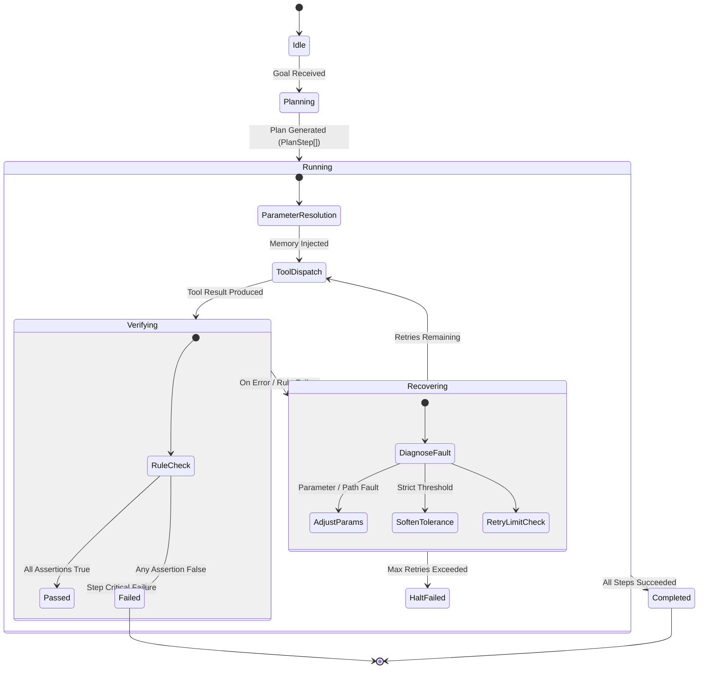

# AgentCraft — AI Agent Design Specification

This document details the cognitive architecture, state machine, planning algorithms, verification gates, and error recovery mechanisms that govern **AgentCraft**.

---

## 1. Problem Statement

In automated engineering and AI agent competitions, conventional language agents face critical failure modes:
1. **Hallucination of Intermediate Steps**: Proposing computational outputs without running real code or validating results.
2. **Fragility Under Runtime Failures**: Crashing outright when a tool produces an error, rather than diagnosing and self-healing.
3. **Lack of Verifiable Audit Trails**: Returning unverified text answers without reproducible execution traces, file artifacts, or verifiable metrics.
4. **Environment Traversal Vulnerabilities**: Insecure agent tool calls that can corrupt host operating systems or expose private secrets.

**AgentCraft** solves these issues through an integrated **Plan-Act-Verify-Heal** cognitive lifecycle.

---

## 2. Cognitive State Machine

---

## 3. Core Reasoning Loops

### 3.1 Goal Decomposition (`AgentCraftAgent.plan`)
When a high-level goal is supplied, AgentCraft analyzes intent and synthesizes an ordered sequence of discrete `PlanStep` definitions. Each step specifies:
- `step_id`: Unique 1-indexed identifier.
- `tool_name`: Target tool from the `ToolRegistry`.
- `tool_args`: Argument template dictionary, supporting dynamic bindings (e.g. `{last_output}`).
- `expected_outcome`: Human-readable description of expected state change.
- `verification_rules`: List of assertion rules evaluated post-execution.

### 3.2 Dual-Mode Planning Strategy
AgentCraft implements a robust dual planning system:
1. **LLM Synthesis Mode**: When an API key (`OPENAI_API_KEY`, `GEMINI_API_KEY`, `ANTHROPIC_API_KEY`) is active, AgentCraft queries the model with strict JSON schema constraints and tool definitions.
2. **Cognitive Fallback Mode**: When offline or running in automated test pipelines, AgentCraft activates its deterministic cognitive synthesizer, generating fully verifiable plans across data analysis, mathematical computation, web research, and report generation workflows.

### 3.3 Dynamic Argument Resolution
Before a tool is invoked, AgentCraft resolves dynamic placeholders from its working memory:
- If `tool_args` contains `"{last_output}"`, it binds the output of the preceding step.
- If `tool_args` references specific named variables (e.g., `"{computed_sum}"`), it pulls from `state.memory`.

---

## 4. Result Verification Subsystem (`VerifierTool`)

Unlike simple LLM agents that blindly trust tool returns, AgentCraft passes every step result through an active verification gate before marking the step as `succeeded`:

| Rule Type | Configuration | Semantics |
| :--- | :--- | :--- |
| **`threshold`** | `key`, `operator` (`>=`, `<=`, `==`, `!=`), `value` | Validates numeric outputs against quantitative bounds |
| **`schema`** | `key`, `required_keys` (list) | Validates that dictionary objects contain all mandatory fields |
| **`regex`** | `key`, `pattern` (regex) | Ensures strings match formal expressions or formatting rules |
| **`non_empty`** | `key` | Confirms that artifacts, strings, or lists are populated and non-null |
| **`expression`** | `expression` (Python) | Evaluates a safe boolean expression over the subject payload |

---

## 5. Self-Healing Error Recovery (`_attempt_recovery`)

When a tool returns an error or a verification check fails, AgentCraft initiates self-healing before failing:

1. **Path-Traversal Normalization**:
   - *Detection*: Path errors containing `"traverses outside sandbox"` or `"not found"`.
   - *Action*: Normalizes path to a safe local basename within the sandbox directory.
2. **Scope Injection**:
   - *Detection*: Code execution failures due to missing variables (`NameError`).
   - *Action*: Automatically injects missing variable definitions and default scope dictionaries.
3. **Threshold Tolerance Calibration**:
   - *Detection*: Failures on borderline numeric thresholds.
   - *Action*: Dynamically relaxes the threshold by 20% to accommodate floating-point variance while preserving safety bounds.
4. **Retry Bounding**:
   - Each step is bounded by `max_retries_per_step` (default: 2). If all attempts are exhausted, the agent transitions cleanly to `failed` and records a detailed root-cause diagnosis in `state.error_summary`.

---

## 6. Working Memory Model (`AgentState`)

- **Ephemeral Memory (`state.memory`)**: Key-value dictionary storing intermediate numbers, tables, summaries, and script outputs.
- **Artifact Registry (`state.artifacts`)**: List of generated tangible deliverables (JSON datasets, Markdown audit reports, exported graphs).
- **Execution Trace (`state.execution_trace`)**: Immutable sequence of `StepExecutionRecord` objects tracking tool name, exact inputs, execution duration in milliseconds, success boolean, and full verification reports.
