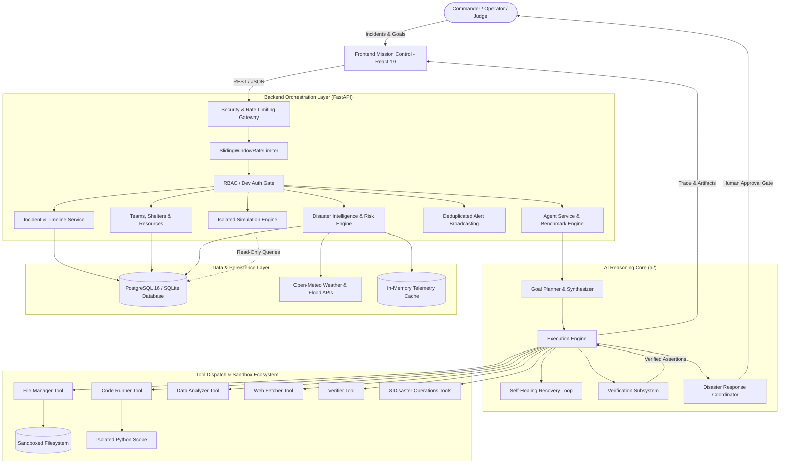
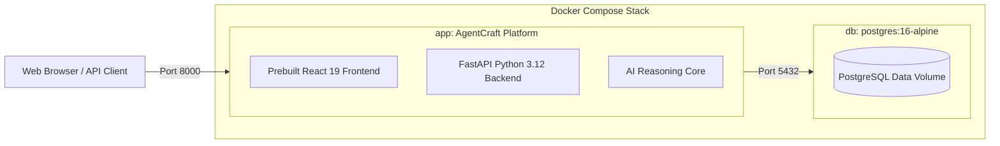

# AgentCraft / RakshaGrid — System Architecture

**AgentCraft / RakshaGrid** is an autonomous AI agent engineering framework and disaster response intelligence platform built for the **AGENTCRAFT 2026 National AI Agent Challenge**. It combines multi-step goal decomposition, typed tool dispatch, deterministic verification gates, sandboxed isolation, self-healing error recovery, explainable disaster risk modeling, multi-hazard simulations, and Common Alerting Protocol (CAP) notifications.

---

## 1. High-Level System Architecture

---

## 2. Component Breakdown

### 2.1 Frontend Mission Control (`frontend/`)
- **Technology**: React 19, Vite 8.3, Vanilla CSS design system (Cyberpunk-Glass aesthetic).
- **Core Views**:
  - `RakshaOverview`: Real-time operational command center with live database KPI rollups or honest empty states.
  - `RakshaIncidents`: Multi-hazard incident management with spatial tracking, severity grading, and situation update timelines.
  - `RakshaLiveMap`: Interactive GIS map rendering incidents, response teams, shelters, and telemetry observations.
  - `RakshaRiskAnalysis`: Explainable 0–100 disaster risk scoring and 6 hypothetical scenario stress-test simulations.
  - `RakshaAgent`: Autonomous AI disaster response coordinator with structured plan generation and mandatory human decision gates.
  - `RakshaAlerts`: CAP-compliant emergency broadcast manager with SHA-256 deduplication and lifecycle tracking.
  - `RakshaSettings`: Operational status monitor, entity registrations, and deterministic development data seeder.

### 2.2 Security & Protection Layer (`backend/rakshagrid/security.py`)
- **SlidingWindowRateLimiter**: Protects sensitive and computationally heavy endpoints (`/intelligence/agent/analyze`, `/simulations/run`, `/alerts/evaluate`, `/api/agent/run`) using an atomic sliding-window algorithm.
- **Production Exception Masker**: Prevents internal stack trace leakage when `AGENTCRAFT_DEBUG=false`, returning safe, audited error codes.
- **Role-Based Authorization (RBAC)**: Validates operations against `admin`, `field_commander`, and `operator` scopes.

### 2.3 Disaster Intelligence Subsystems
- **Risk Scoring Engine (`backend/services/risk_engine.py`)**: Computes a deterministic 0–100 risk score based on hazard baseline, severity, operational status, hydro-meteorological telemetry, and population exposure.
- **Disaster Data Service (`backend/services/external_data_service.py`)**: Fetches live weather forecasts and river flood gauges from Open-Meteo, with an in-memory 15-minute TTL cache and resilient heuristic fallbacks.
- **Scenario Simulation Service (`backend/services/simulation_service.py`)**: Evaluates 6 disaster stress scenarios (heavy rainfall, multi-incident surge, team unavailability, shelter overflow, supply deficit, cascading crisis) with strictly guaranteed database isolation.
- **Alert Service (`backend/services/alert_service.py`)**: Evaluates threshold breaches and generates CAP-compliant alerts with SHA-256 deduplication and 15-minute cooldown suppression.

### 2.4 AI Reasoning Core (`ai/`)
- **AgentCraftAgent (`ai/agent.py`)**: Autonomous cognitive loop supporting Plan-Act-Verify-Heal execution.
- **Disaster Response Tools (`ai/tools/disaster_tools.py`)**: 8 formal tools subclassing `BaseTool` (`get_incident_details`, `get_incident_risk`, `get_weather_observations`, `get_available_teams`, `get_active_tasks`, `get_shelter_capacity`, `get_resource_inventory`, `propose_response_plan`).
- **VerifierTool (`ai/tools/verifier.py`)**: Multi-criteria assertion evaluator enforcing correctness contracts before step completion.
- **Human Decision Gate**: Consequential dispatches cannot be committed autonomously; the agent generates a structured plan requiring explicit human commander approval.

---

## 3. Data Integrity & Persistence Architecture

1. **Transactional Operations**: Resource stock allocations and shelter admissions operate within atomic database transactions with rollback guards.
2. **Relational Constraints**:
   - `CheckConstraint("quantity_available >= 0")` guarantees zero negative inventory.
   - `CheckConstraint("current_occupancy <= capacity")` ensures shelter capacity is never breached.
   - Foreign-key cascades and indexes maintain referential consistency across incidents, updates, teams, tasks, alerts, and risk assessments.
3. **Database Portability**: Runs seamlessly on PostgreSQL 16 (in Docker/production) or SQLite3 (in local dev/testing) via SQLAlchemy 2.0 and Alembic migrations.

---

## 4. Container & Deployment Architecture

- Multi-stage `Dockerfile` combines Node 20 for compiling frontend static assets and Python 3.12-slim for serving the production API and prebuilt UI on a single unified port.
