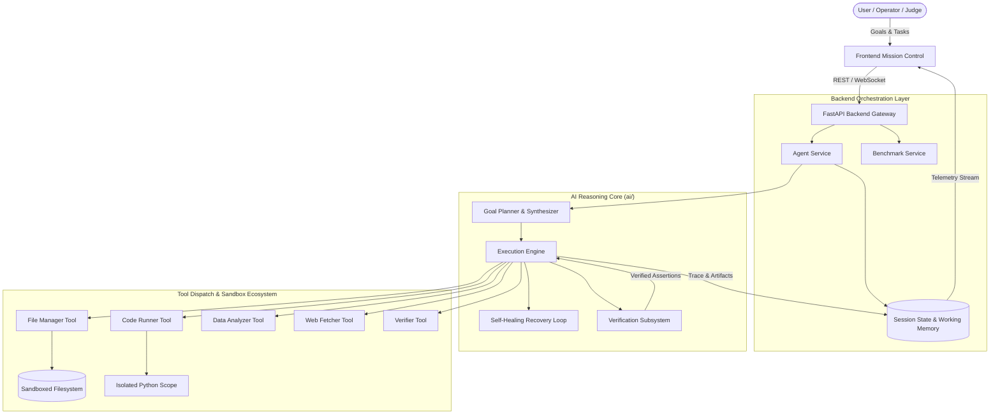
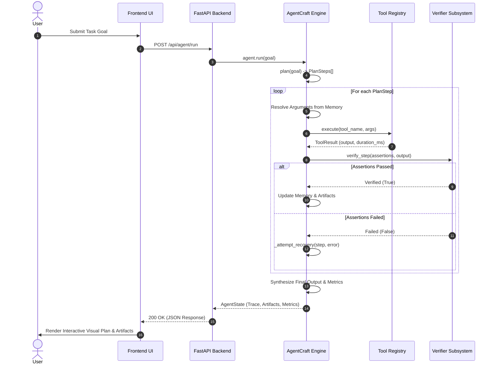

# AgentCraft — System Architecture

**AgentCraft** is an autonomous AI agent engineering framework built for the **AGENTCRAFT 2026 National AI Agent Challenge**. It combines multi-step goal decomposition, typed tool dispatch, deterministic verification gates, sandboxed isolation, and self-healing error recovery.

---

## 1. High-Level System Architecture

---

## 2. Component Breakdown

### 2.1 Frontend Mission Control (`frontend/`)
- **Technology**: React 19, Vite, Vanilla CSS design system (custom cyberpunk-glass aesthetic).
- **Responsibilities**:
  - Goal entry console with preset challenge templates.
  - Interactive multi-step execution plan timeline (DAG/linear).
  - Real-time terminal streaming logs and status indicators.
  - Deep-dive audit trace inspector displaying inputs, outputs, execution latencies, and assertion proofs.
  - One-click AGENTCRAFT 2026 capability benchmark dashboard.
  - Tool catalog browser showing available parameter schemas.

### 2.2 Backend Gateway & Orchestrator (`backend/`)
- **Technology**: FastAPI, Uvicorn, Pydantic v2, Python 3.12.
- **Responsibilities**:
  - Exposes RESTful endpoints for autonomous execution, session lifecycle management, step-by-step control, and benchmark running.
  - Houses `AgentService` for session state tracking and persistence.
  - Implements `BenchmarkService` for quantitative evaluation against competition criteria.
  - Enforces CORS policies, input validation, and structured error responses.

### 2.3 AI Reasoning Core (`ai/`)
- **Technology**: Pure Python reasoning engine with dual-mode execution (LLM-enabled and cognitive-deterministic).
- **Responsibilities**:
  - **Goal Decomposition**: Analyzes user intent and produces ordered, dependency-aware `PlanStep` graphs.
  - **Execution Engine**: Resolves dynamic memory variables (e.g. `{last_output}`, `{variable_name}`) and dispatches tools.
  - **Verification Subsystem**: Evaluates multi-criteria assertions (thresholds, schemas, regex, non-empty, expressions) before accepting step outputs.
  - **Self-Healing Recovery**: Dynamically catches runtime exceptions, path violations, or verification rejections, applying recovery tactics (path normalization, context defaults, tolerance adjustment) within strict retry bounds.
  - **Result Synthesis**: Compiles complete execution traces, generated artifacts, and confidence scores into verifiable audit records.

### 2.4 Tool Ecosystem (`ai/tools/`)
All tools inherit from `BaseTool` and return standardized `ToolResult` schemas:
- `code_runner`: Sandboxed Python execution capturing stdout/stderr and exporting generated variables.
- `file_manager`: Safe file creation, reading, directory listing, and regex search with path-traversal prevention.
- `data_analyzer`: Statistical profiling, IQR outlier detection, column summaries, and aggregations.
- `web_fetcher`: Real HTTP requests with fallbacks to offline structured knowledge retrieval for deterministic testing.
- `verifier`: Post-step assertion engine evaluating contract compliance.

---

## 3. Data Flow & Execution Sequence

---

## 4. Security & Sandboxing Model

1. **Path-Traversal Guards**: `FileManagerTool` normalizes all relative file paths against `temp_sandbox` and rejects attempts to write or read outside designated root boundaries.
2. **Execution Scope Isolation**: `CodeRunnerTool` runs scripts in an isolated dictionary scope with standard output redirection and restricted globals, preventing unauthorized environment destruction.
3. **Secret Segregation**: API keys (`OPENAI_API_KEY`, `GEMINI_API_KEY`, `ANTHROPIC_API_KEY`) reside exclusively in environment variables (`.env`) and are never leaked to frontend clients or persisted traces.
