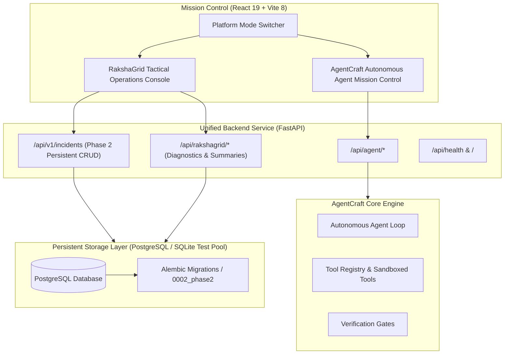

# RakshaGrid — Disaster Intelligence and Response

**RakshaGrid** is a mission-critical disaster-management, hazard-monitoring, and emergency-response coordination platform built on the **AgentCraft** autonomous AI agent engine.

---

## 1. Project Purpose & Scope

During acute catastrophic events—such as flash floods, cyclonic storm surges, landslides, wildfires, and earthquakes—coordination between emergency operation centers (EOCs), first responders (NDRF, SDRF, Medical Triage), relief shelters, and vulnerable populations is compromised by fragmented communication and delayed situational intelligence.

RakshaGrid provides a unified operational command console to:
- Ingest and classify multi-hazard disaster incidents with persistent database backing.
- Track evacuation shelters, available capacity, and critical life-support supplies.
- Dispatch and monitor specialized emergency response teams and tactical tasks.
- Broadcast emergency alerts conforming to the **Common Alerting Protocol (CAP v1.2)** standard.
- Model multi-hazard compound risks and simulate mitigation scenarios.
- Maintain an immutable, transactionally enforced audit trail of all command decisions and resource transfers.

---

## 2. Architecture & Coexistence with AgentCraft

RakshaGrid is integrated directly into the AgentCraft platform without breaking existing agent capabilities:



---

## 3. Database Architecture & Data Models (Phase 2)

RakshaGrid uses **SQLAlchemy 2.0** and **Alembic** for version-controlled, relational persistence. Cross-engine compatibility is guaranteed via `sa.Uuid` (native `UUID` in PostgreSQL, string-backed GUID in SQLite test fixtures).

### 3.1 Incident Table (`incidents`)

| Field | Type | Constraints | Description |
|---|---|---|---|
| `id` | UUID | Primary Key, Indexed | Unique incident identifier |
| `incident_code` | String(32) | Unique, Indexed | Human-readable tactical code (e.g., `RG-2026-FL-0001`) |
| `title` | String(255) | Non-null, Min length 5 | Operation/incident title |
| `description` | Text | Nullable | Detailed incident overview and field observations |
| `category` | String(64) | Check Enum, Indexed | `flood`, `severe_weather`, `wildfire`, `earthquake`, `landslide`, `industrial_accident`, `other` |
| `severity` | String(32) | Check Enum, Indexed | `low`, `medium`, `high`, `critical` |
| `status` | String(32) | Check Enum, Indexed | `reported`, `under_assessment`, `confirmed`, `response_active`, `contained`, `resolved`, `closed` |
| `latitude` | Numeric(9,6) | Check `-90 <= lat <= 90` | WGS84 Latitude coordinate |
| `longitude` | Numeric(9,6) | Check `-180 <= lon <= 180` | WGS84 Longitude coordinate |
| `location_description` | String(255) | Nullable | Human-readable location / sector description |
| `source_type` | String(32) | Check Enum | `operator_report`, `external_source`, `simulation` |
| `verification_status` | String(32) | Check Enum | `unverified`, `under_review`, `verified` |
| `reported_at` | DateTime(tz) | Indexed | Incident reporting timestamp |
| `created_by` | String(128) | Nullable | User ID / callsign of reporting operator |
| `assigned_commander` | String(128) | Nullable | Field commander designated for incident response |
| `affected_population` | Integer | Check `>= 0` | Estimated vulnerable or impacted population |
| `created_at` | DateTime(tz) | Non-null, Server default | Creation timestamp |
| `updated_at` | DateTime(tz) | Non-null, Auto-updated | Last modification timestamp |

### 3.2 Incident Timeline & History Table (`incident_updates`)

Every meaningful modification, state transition, and situation report is transactionally recorded in `incident_updates`. Normal users cannot modify or delete historical records.

| Field | Type | Description |
|---|---|---|
| `id` | UUID | Primary Key |
| `incident_id` | UUID | Foreign Key -> `incidents.id` (ON DELETE CASCADE) |
| `actor_id` | String(128) | User / operator ID or system agent responsible for update |
| `previous_status` | String(32) | Prior status value before transition (null for sitreps) |
| `new_status` | String(32) | Resulting status value after transition |
| `update_type` | String(64) | `status_change`, `situation_report`, `operator_note`, `operational_dispatch`, `system_event` |
| `update_message` | Text | Human-readable audit narrative or sitrep text |
| `metadata_payload` | JSON / Text | Structured context (changed fields, client IP, coordinates) |
| `created_at` | DateTime(tz) | Timestamp of event recording (indexed, chronological) |

### 3.3 Transaction Handling & History Guarantees
All incident creations and updates execute inside atomic SQLAlchemy transactions. If an error occurs while persisting timeline history, the entire transaction rolls back cleanly, preventing orphan state.

---

## 4. RESTful API Endpoints (`/api/v1/incidents`)

Implemented in `backend/routes/incident_routes.py` with service logic in `backend/rakshagrid/incident_service.py`:

| Method | Endpoint | Allowed Roles | Description |
|---|---|---|---|
| `GET` | `/api/v1/incidents` | Public / All | Paginated incident list with filtering (`category`, `severity`, `status`, `verification_status`), text search, and sorting. Page size capped at 100. |
| `POST` | `/api/v1/incidents` | Operator, Commander, Admin | Create and persist new incident with automatic history creation. |
| `GET` | `/api/v1/incidents/{id}` | Public / All | Retrieve full incident details by UUID. Returns 404 if not found. |
| `PATCH` | `/api/v1/incidents/{id}` | Operator, Commander, Admin | Update permitted incident fields, enforce state progression rules, and record audit update. |
| `GET` | `/api/v1/incidents/{id}/updates` | Public / All | Retrieve chronological timeline and situation reports for an incident. |
| `POST` | `/api/v1/incidents/{id}/updates` | Operator, Commander, Admin | Post situation report or operational note to the incident timeline. |
| `DELETE` | `/api/v1/incidents/{id}` | Admin, Commander | Soft-archive incident (status set to `closed`) to preserve operational integrity. |
| `POST` | `/api/v1/incidents/seed` | Admin, Commander | Insert deterministic fictional development records (`source_type: simulation`). |

### Example Request: Create Incident
```http
POST /api/v1/incidents HTTP/1.1
Content-Type: application/json
X-Rakshagrid-Dev-Role: operator
X-Rakshagrid-Dev-User: ops-srinagar-01

{
  "title": "Severe Riverine Inundation in Srinagar Ward 4",
  "category": "flood",
  "severity": "high",
  "status": "reported",
  "latitude": 34.0837,
  "longitude": 74.7973,
  "location_description": "Upper Jhelum Basin, Rajbagh Perimeter",
  "affected_population": 4500,
  "source_type": "operator_report",
  "verification_status": "verified",
  "description": "Embankment breach reported near Rajbagh. Water levels rising rapidly."
}
```

---

## 5. Security & Authorization

RakshaGrid implements a tiered role-based access control (RBAC) model:
- **`public`**: Unauthenticated read access to verified incidents and alerts. Cannot create or modify records.
- **`operator`**: Authenticated triage operators who can log incidents, file sitreps, and transition statuses.
- **`commander`**: Tactical incident commanders who can assign response teams, update risk posture, and archive records.
- **`admin`**: System administrators with full administrative capabilities.

### Development Mode vs. Production Authentication
- In development (`RAKSHAGRID_DEV_AUTH_ENABLED=true`), simulated identity headers (`X-Rakshagrid-Dev-Role`, `X-Rakshagrid-Dev-User`) are accepted for local testing.
- When `RAKSHAGRID_DEV_AUTH_ENABLED=false` (production), simulated headers are strictly rejected and cryptographic JWT bearer token verification is enforced.

---

## 6. Frontend Tactical Operations Console (Phase 2)

The React 19 frontend is connected directly to `/api/v1/incidents`:
- **Live Persistence**: Refreshing the browser preserves all database records.
- **Interactive Triage Form**: Complete validation of titles, coordinate boundaries (-90 to 90 / -180 to 180), and non-negative populations.
- **Chronological Timeline**: Visual audit feed displaying state transitions and operator sitreps.
- **State Transition Controls**: Interactive progression dropdowns enforcing operational lifecycle rules.
- **Search & Filters**: Debounced multi-field search and category/severity/status filtering.
- **Graceful Error Handling**: If PostgreSQL is unreachable, a clear `ErrorState` prompt is shown with retry controls instead of silently falling back to mock data.

---

## 7. Development Seed Script

To populate a local development database with deterministic, clearly tagged simulated records:
```bash
# Via Python CLI:
.\.venv\Scripts\python.exe -m backend.scripts.seed_dev_data

# Or via REST API:
curl -X POST http://127.0.0.1:8000/api/v1/incidents/seed -H "X-Rakshagrid-Dev-Role: admin"
```

All seeded incidents:
- Use codes `RG-2026-SIM-0001` through `RG-2026-SIM-0005`.
- Are explicitly flagged with `source_type: "simulation"`.
- Are idempotent: running the command multiple times will not create duplicates.

---

## 8. Migration Commands

To manage PostgreSQL schema versions:
```bash
# Check current migration revision
alembic current

# Apply all migrations to head
alembic upgrade head

# Downgrade one revision
alembic downgrade -1
```

Migration revisions:
- `0001_initial_rakshagrid_schema.py`: Initial 11-table schema models.
- `0002_phase2_incident_management.py`: Enhanced incident and timeline fields, check constraints, and performance indexes.

---

## 9. Verification & Test Suite

All 69 automated tests pass cleanly without requiring external network access:

```bash
.\.venv\Scripts\python.exe -m pytest ai/tests backend/tests -v
```

Test coverage includes:
- AgentCraft core reasoning loop & tool sandboxes (28 tests)
- AgentCraft API & verification endpoints (14 tests)
- RakshaGrid subsystem diagnostics & health (11 tests)
- RakshaGrid Phase 2 Incident Management API (16 tests):
  - Incident creation and title validation
  - Normalization of legacy categories/severities
  - Coordinate bounds validation (lat [-90, 90], lon [-180, 180])
  - Non-negative population check
  - Invalid UUID format rejection (422)
  - Missing incident rejection (404)
  - Max page size enforcement (<= 100)
  - Database persistence and transaction rollback on audit failure
  - Valid and invalid status transitions
  - Chronological timeline logging
  - Search and multi-filter querying
  - Role-based authorization & archival workflow
  - Deterministic dev seeder idempotence

Frontend build verification:
```bash
cd frontend
npm run lint    # 0 errors
npm run build   # Production bundle built in 215ms
```

---

## 10. Phase Roadmap

### Completed in Phase 1
- [x] Application shell, responsive sidebar, and tactical navigation for all 11 modules.
- [x] Dark charcoal, warm off-white, muted olive, and restrained amber/red design system.
- [x] Overview dashboard with threat level, KPI cards, incident tables, and alert streams.
- [x] Dedicated view components for all 11 modules.
- [x] 11 SQLAlchemy models and Alembic migration foundation.
- [x] 53 passing automated tests.

### Completed in Phase 2
- [x] PostgreSQL database connection configuration & session lifecycle management.
- [x] Persistent `incidents` and `incident_updates` tables with check constraints and indexes.
- [x] Transactional consistency: creation and updates recorded in history atomically with rollback.
- [x] RESTful incident management API (`/api/v1/incidents`) with filtering, search, and pagination.
- [x] Pydantic v2 validation schemas and status transition validation.
- [x] Server-side role-based authorization with safe development mode.
- [x] React 19 frontend integration with real `/api/v1/incidents` backend.
- [x] Incident detail modal with chronological timeline and sitrep submission form.
- [x] Deterministic development seeder (`backend/scripts/seed_dev_data.py`).
- [x] 69 passing automated tests.

### Deferred to Phase 3
- [ ] Leaflet / Mapbox GIS map integration with dark vector tile rendering and live incident markers.
- [ ] CAP v1.2 alert broadcast engine with multi-channel dispatch simulation.
- [ ] Tactical response team mobilization and resource tracking.
- [ ] Relief shelter occupancy management and check-in barcode workflows.
