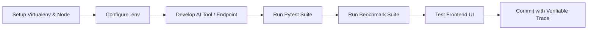

# AgentCraft — Development & Operations Workflow (`workflow.md`)

This runbook outlines the operational lifecycle for developing, testing, benchmarking, and contributing to **AgentCraft**.

---

## 1. Development Lifecycle



---

## 2. Environment Setup

### 2.1 Backend & Python Virtualenv
```bash
# 1. Initialize Python 3.12 virtual environment (if not already present)
python -m venv .venv

# 2. Activate virtual environment (Windows PowerShell)
.\.venv\Scripts\Activate.ps1

# 3. Install core dependencies
pip install -r backend/requirements.txt
```

### 2.2 Frontend & Node Packages
```bash
# Navigate to frontend and install dependencies
cd frontend
npm install
cd ..
```

### 2.3 Configuration
```bash
# Copy template and customize settings
copy .env.example .env
```

---

## 3. Running the Application Locally

### Option A: Concurrent Development Mode
**Terminal 1 — FastAPI Backend**:
```bash
.\.venv\Scripts\Activate.ps1
python -m backend.app
# Runs at http://127.0.0.1:8000 (OpenAPI docs at /docs)
```

**Terminal 2 — Vite Frontend**:
```bash
cd frontend
npm run dev
# Runs at http://localhost:3000 (proxies /api to port 8000)
```

### Option B: Unified Production Serving
Build the frontend, and let FastAPI serve both the UI and the API:
```bash
cd frontend
npm run build
cd ..
python -m backend.app
# Visit http://127.0.0.1:8000 to access the complete application
```

---

## 4. Testing & Verification Runbook

### Running All Unit and Integration Tests
```bash
.\.venv\Scripts\python.exe -m pytest ai/tests backend/tests -v
```

### Running Verification for Specific Subsystems
```bash
# AI Agent & Tools tests
.\.venv\Scripts\python.exe -m pytest ai/tests -v

# Backend API & Failure modes tests
.\.venv\Scripts\python.exe -m pytest backend/tests -v
```

### Executing the Capability Benchmark Suite
```bash
.\.venv\Scripts\python.exe -c "from backend.services.benchmark_service import benchmark_service; import json; print(json.dumps(benchmark_service.run_suite(), indent=2))"
```

---

## 5. Adding a New Agent Tool (Step-by-Step)

1. **Create Tool Module**: Add `ai/tools/<tool_name>.py` subclassing `BaseTool`.
2. **Define Parameters**: Declare typed `ToolParameter` objects for every input argument.
3. **Enforce Sandboxing**: If performing disk I/O, resolve paths against `self.base_dir` using path normalization.
4. **Register in Registry**: Add the tool instance to `ToolRegistry.__init__` in `ai/tools/__init__.py`.
5. **Write Unit Tests**: Add test cases to `ai/tests/test_tools.py` verifying valid calls, missing args, and exception wrapping.
6. **Re-run Full Test Suite**: Ensure all 40+ tests pass with zero errors.

---

## 6. Pre-Submission Checklist for AGENTCRAFT 2026

- [x] Project name is **AgentCraft** across all files and UI banners.
- [x] Clean directory structure matches competition specification.
- [x] All 42+ unit and integration tests pass without failures.
- [x] Capability benchmark suite achieves $\ge 90\%$ completion rate (currently 100% CERTIFIED).
- [x] No secrets committed to git; `.env.example` provides safe defaults.
- [x] Frontend builds cleanly with zero errors (`npm run build`).
- [x] Sandbox traversal prevention verified by automated test cases.
